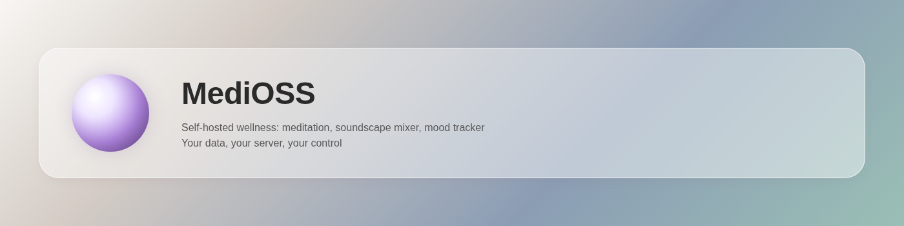
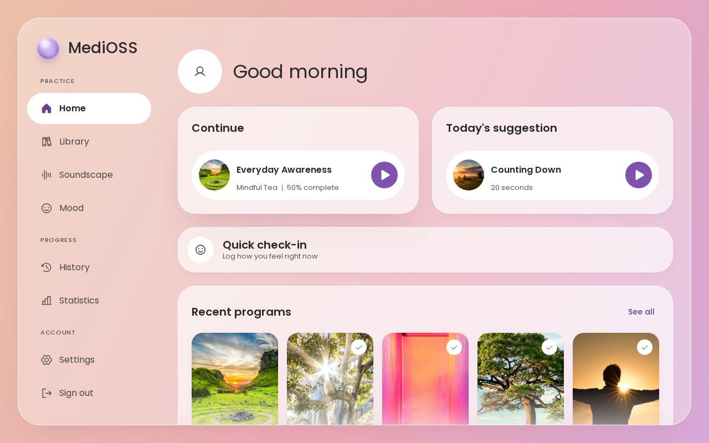

<!-- markdownlint-disable-file MD041 -->

<p align="center">
  
</p>

# MediOSS

[](https://github.com/ahmet-cetinkaya/medioss/actions/workflows/ci.yml) [](https://github.com/ahmet-cetinkaya/medioss/stargazers) [](LICENSE) [](https://ahmetcetinkaya.me/donate)

A self-hosted wellness app for calmer days: a meditation library, an ambient soundscape mixer, and a mood tracker, all behind one account on your own server. Your data stays in one SQLite file that you control.

<p align="center">
  
</p>

## ✨ Features

- **Meditation library** — upload your own guided sessions, group them in programs with covers, and track your practice
- **Soundscape mixer** — mix built-in and uploaded ambient sounds and save your mixes
- **Mood tracking** — daily mood entries with notes, history, and statistics
- **Multi-user** — admin-created accounts with per-user data isolation (no public signup)
- **Data portability** — export and import your mood and practice data as JSON or CSV
- **Private by design** — no third-party services, no tracking, no accounts elsewhere
- **Responsive UI** — mobile-first "Soft Glass" design

More screens: [library](docs/screenshots/library-desktop.png), [program](docs/screenshots/program-desktop.png), [player](docs/screenshots/player-desktop.png), [soundscape](docs/screenshots/soundscape-desktop.png), [mood](docs/screenshots/mood-desktop.png), [statistics](docs/screenshots/stats-desktop.png).

## ⏬ Installation

### 🐳 Docker (recommended)

```bash
git clone https://github.com/ahmet-cetinkaya/medioss.git
cd medioss
cp .env.example .env
# Edit .env: set SESSION_SECRET (generate with: openssl rand -base64 32)
# and MEDIOSS_ORIGIN (e.g. http://localhost:3000 or your domain)
docker compose up -d   # pulls ghcr.io/ahmet-cetinkaya/medioss:latest
```

Pin a release with `MEDIOSS_VERSION=1.0.0` in `.env`. To build from source instead, run `make docker-up`. See [docs/docker.md](docs/docker.md).

Open `http://localhost:3000` (or your `MEDIOSS_ORIGIN`) and register the first admin.

### 📦 From source (development)

Requires: Rust + Cargo, Node.js + Bun, FFmpeg.

```bash
git clone https://github.com/ahmet-cetinkaya/medioss.git
cd medioss
cp .env.example .env
# Edit .env as above
make run  # build the UI, then serve API + UI from one process on :3000
```

## ⚙️ Configuration

Set these in `.env` or as environment variables (env vars take priority):

| Variable | Required | Default | Notes |
| --- | --- | --- | --- |
| `MEDIOSS_DATA_DIR` | ✓ | (none) | Directory for SQLite DB + media files; created if missing |
| `SESSION_SECRET` | ✓ | (none) | Strong random secret; generate: `openssl rand -base64 32` |
| `MEDIOSS_ORIGIN` | ✓ | (none) | Single origin the app is served from (scheme + host + optional port, no path) |
| `PORT` |  | 3000 | Listen port |
| `MEDIOSS_BIND` |  | 0.0.0.0 | Listen address; use `127.0.0.1` for localhost only |
| `SESSION_TIMEOUT` |  | 7d | Session lifetime (e.g. `7d`, `24h`, `30m`) |
| `SESSION_COOKIE_SECURE` |  | true | Set to `false` only for local HTTP testing (not production) |
| `MEDIOSS_BUILTIN_SOUNDS_DIR` |  | (probed) | Built-in sound set. Unset: the server tries `/srv/medioss/builtin-sounds` (Docker image), then `./builtin-sounds`. `make run` / `make dev` do not set it, so set it to `$PWD/assets/sounds/soundscape-builtin` for built-in sounds from a checkout without `.env` |

See [`.env.example`](.env.example) for all options and full descriptions.

## 🔧 Development

### Quick start

```bash
make dev      # Astro dev server (:4321, proxies /api) + cargo-watch API (:3000)
make run      # build the UI, then serve API + UI from one process on :3000
make build    # build the release binary with the UI bundled
make format   # prettier + cargo fmt
make lint     # prettier --check, cargo fmt --check, clippy -D warnings, boundary check
make test     # bun test, cargo test --workspace, boundary-check self-test
make clean    # remove target/, the built UI and the static dir
```

`make run` / `make dev` do not set `MEDIOSS_BUILTIN_SOUNDS_DIR` (the copied `.env` from `.env.example` does, relative to the repo root). Without it there are no built-in sounds, so point the server at them: `MEDIOSS_BUILTIN_SOUNDS_DIR=$PWD/assets/sounds/soundscape-builtin make run`.

Docker and demo targets:

```bash
make docker-build    # docker compose -f docker-compose.dev.yml build
make docker-up       # build from source and start (docker-compose.dev.yml)
make docker-down     # stop and remove the containers (keeps the volume)
make docker-restart  # rebuild and recreate the containers
make docker-logs     # follow the logs
make demo            # seed a throwaway instance and write screenshots (docs/demo.md)
make demo-seed       # seed demo content into a running empty instance
make demo-screenshots # capture screenshots from a seeded instance
```

See [docs/DEPLOYMENT.md](docs/DEPLOYMENT.md) for Docker production setup and [docs/ARCHITECTURE.md](docs/ARCHITECTURE.md) for codebase structure.

### Stack

- **Backend** —    
- **Frontend** —     
- **Storage** —  (single file, no server needed)
- **Media** —  for audio transcoding; WebP normalization for images
- **Deployment** — 

## 📚 Documentation

- [**ARCHITECTURE.md**](docs/ARCHITECTURE.md) — module structure, design patterns, data layout
- [**DEPLOYMENT.md**](docs/DEPLOYMENT.md) — production setup, reverse proxies, backup
- [**docker.md**](docs/docker.md) — image building and publishing
- [**DESIGN_SYSTEM.md**](docs/DESIGN_SYSTEM.md) — UI component library and design tokens
- [**PRD.md**](docs/PRD.md) — product requirements and feature details
- [**ROADMAP.md**](docs/ROADMAP.md) — future plans
- [**Security Policy**](SECURITY.md) — vulnerability reporting and supported versions

## 🤝 Contributing

Contributions are welcome. Before you start, please read [CONTRIBUTING.md](CONTRIBUTING.md) for:

- Environment setup
- Code style and patterns
- Pull request process
- Issue reporting and testing requirements

## 📄 License

MediOSS is licensed under the [GNU Affero General Public License v3.0 or later](LICENSE) — see the license file for details.

Your instance's source code and modifications must remain available to your users under the same license.
